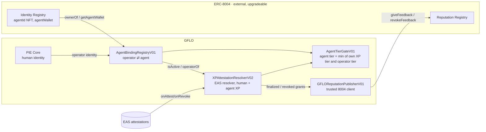

# DESIGN-003 — Operator binding and ERC-8004 integration

Date: 2026-11-18 · Status: **design proposal**, nothing implemented or deployed, not audited
Builds on: DECISION-002 (EAS resolver), `XPAttestationResolverV01`, `EffectiveTierGateV01`

## 0. One-sentence thesis

> **An AI agent's trust can never exceed the trust of the accountable human behind it,
> and it can only be earned by verified work, never bought or transferred.**

This is the original GFLO idea (*Activity → XP → Identity → Sovereignty*, anti-plutocratic)
applied to agents. The human stays the sovereign subject; agents are delegates whose
reputation is earned, revocable and capped by their operator.

## 1. What ERC-8004 gives us, and what it leaves open

Source: `erc-8004/erc-8004-contracts` (spec copy `ERC8004SPEC.md` and the three
contracts, master branch, read 2026-11-18). The standard is a **Draft** (created 2025-08-13).

| Registry | What it does | Relevant detail |
|---|---|---|
| Identity | Agent = ERC-721 token, `agentId` = tokenId; `agentURI` points to the registration JSON | `setAgentWallet` is proven by an EIP-712 signature of the wallet (ECDSA, falls back to ERC-1271). **On any transfer the agent wallet is cleared.** |
| Reputation | `giveFeedback(agentId, int128 value, uint8 valueDecimals, tag1, tag2, endpoint, feedbackURI, feedbackHash)` | Only the owner and approved operators are blocked from rating their own agent. **Any other address can rate.** `getSummary` *requires* a `clientAddresses` list: the reader decides whose feedback counts. Clients can `revokeFeedback`. |
| Validation | `validationRequest` / `validationResponse` (0–100) by a named validator | Marked unstable ("still under active update"); **no deployed address** in the official README. |

Deployed (official README): Identity + Reputation at the same addresses on Ethereum,
Base and ~40 other chains, e.g. Sepolia / Base Sepolia Identity
`0x8004A818BFB912233c491871b3d84c89A494BD9e`, Reputation
`0x8004B663056A597Dffe9eCcC1965A193B7388713`. All three are **UUPS-upgradeable** by
their owner.

**The gap.** Creating extra wallets to rate your own agent is free, so raw ERC-8004
feedback is Sybil-farmable by design. That is why the summary needs a trusted client
list. An empirical study (arXiv 2606.26028, as reported in search results; the paper itself
was not reachable from this environment) counted about **505,567 `giveFeedback` calls from only
21,872 distinct addresses** up to 2026-09-01. ERC-8004 standardises *where* reputation lives;
it does not answer *whose reputation is trustworthy*.

**GFLO's role:** be a **trusted client and evidence layer** inside ERC-8004. Its feedback
is backed by EAS evidence, a challenge period, revocation, caps and an accountable,
Sybil-limited human operator. We do **not** fork or replace ERC-8004.

## 2. Architecture



Data flows **into** GFLO from ERC-8004 only as identity facts (`ownerOf`, `getAgentWallet`).
Raw ERC-8004 feedback is **never** imported as XP.

## 3. Operator binding — `AgentBindingRegistryV01`

### 3.1 Roles

- **Operator**: a human with a PIE identity (`PIECore.getIdentity(op).exists`), the
  ERC-721 owner of the ERC-8004 agent. Accountable party.
- **Agent**: an ERC-8004 `agentId` plus its verified `agentWallet`. The wallet is the EAS
  recipient for agent XP.

### 3.2 Binding record

```solidity
struct Binding {
    address operator;      // ownerOf(agentId) at bind time
    address agentWallet;   // getAgentWallet(agentId) at bind time, must be non-zero
    uint64  boundAt;
    uint32  epoch;         // increments on every (re)bind of this agentId
    bool    suspended;     // governance or strike suspension
}
mapping(uint256 agentId => Binding) public bindings;
mapping(address agentWallet => uint256 agentId) public agentOfWallet;  // 1 wallet ↔ 1 agent
mapping(address operator => uint16) public activeAgentCount;
```

### 3.3 Functions (sketch)

```solidity
function bind(uint256 agentId) external;          // msg.sender == identity.ownerOf(agentId)
function unbind(uint256 agentId) external;        // operator, or anyone if binding is stale
function suspend(uint256 agentId, bytes32 reason) external;  // governance
function isActive(uint256 agentId) external view returns (bool);
function operatorOf(address agentWallet) external view returns (address operator, uint256 agentId, uint32 epoch);
```

`bind` requires:
1. `msg.sender == identity.ownerOf(agentId)`. Approved operators and `isApprovedForAll`
   are **not** enough: accountability needs the owner itself.
2. The operator has a PIE identity, and `operator != agentWallet`. A human is never their own agent.
3. `agentWallet = identity.getAgentWallet(agentId)` is non-zero and not bound to another
   agent. ERC-8004 already proved control of that wallet with an EIP-712/1271 signature.
4. **Slot limit by the operator's effective tier** (anti-plutocratic: slots come from
   verified work, not money):

   | Operator effectiveTier | Max active agents |
   |---|---|
   | 0 | 1 |
   | 1 | 3 |
   | 2 | 10 |

5. The operator has no active strike suspension (§5).

### 3.4 `isActive` — fail-closed, checked live on every use

```
binding exists && !suspended
&& identity.ownerOf(agentId) == binding.operator
&& identity.getAgentWallet(agentId) == binding.agentWallet
&& operator not strike-suspended
```

Any ERC-8004 call that reverts makes the agent **inactive**: we read a third-party
upgradeable contract, so an error must never grant rights.

### 3.5 Reputation is not transferable

If the agent NFT is sold or transferred, `ownerOf` changes and ERC-8004 clears the wallet,
so the binding goes inactive immediately. A new owner may `bind` again, but gets a **new
`epoch`**, and agent XP is keyed by `(agentId, epoch)`, so it **starts from zero**.

This is the anti-plutocratic core in agent form: **you cannot buy a reputable agent.**
The old history stays readable (and published in ERC-8004 under the old epoch), but
it gives the new owner no rights.

## 4. XP for agents — `XPAttestationResolverV02`

Same rules as V01 (DECISION-002), with a subject-aware schema:

```
bytes32 ruleId, bytes32 eventId, bytes32 evidenceDigest, uint256 agentId   (revocable, no expiry)
```

`agentId == 0` means a human subject (V01 behaviour). For `agentId != 0`:

| Check | Why |
|---|---|
| `binding.isActive(agentId)` and `recipient == binding.agentWallet` | evidence is about this exact, currently accountable agent |
| `attester != operator` | an operator cannot attest their own agent |
| attester is not an agent of the same operator (`operatorOf(attester)`) | blocks sibling-agent collusion |
| rule is flagged `agentEligible` | humans and agents earn on separate rule sets |
| own caps per `(agentId, epoch)`: daily / weekly / per rule | an agent fleet cannot farm faster than one agent |

Ledgers stay separate: `validEarnedXP[human]` and `agentXP[agentId][epoch]`.
**Operators do not earn XP from their agents' work.** Otherwise a fleet of agents
would be a way to buy human reputation.

Evidence sources that fit agents well, because they are machine-checkable:
merged pull request + passing CI run, executed and settled task/payment receipt
(for example an x402 payment receipt hash), reproducible benchmark run. The
`evidenceDigest` commits to the artefact; the attester (CI bot or Safe) signs the EAS
attestation.

## 5. Operator accountability (strikes)

- When governance revokes an **agent** grant with a fraud-class reason
  (`reason ∈ {FRAUD, FABRICATED_EVIDENCE, COLLUSION}`), the operator gets a strike.
- Strikes decay after 90 days.
- ≥ 3 live strikes: **all** of the operator's agents become inactive, and new binds are blocked
  until the count drops.
- Attester withdrawal (`ATTESTER_WITHDREW`) is **not** a strike; honest corrections must stay cheap.
- The operator's own human XP is not reduced. Strikes limit delegation, not personhood.
  Governance may still revoke human grants separately.

## 6. Agent effective tier — `AgentTierGateV01`

```
agentTier(agentId) = min( tierFromXP(agentXP[agentId][epoch]),
                          operatorEffectiveTier )          // never above its human
                     and 0 if !isActive(agentId)
```

Tier → permission is decided by the **consumer** (marketplace, payment rail, API); GFLO only
supplies the number. Example policy a consumer might adopt:

| agentTier | Example meaning |
|---|---|
| 0 | read-only / sandbox |
| 1 | small autonomous spend, human co-sign above it |
| 2 | full delegated spend within the operator's limits |

`requireAgentTier(agentId, min)` reverts when the agent is inactive, or when the resolver or
registry is paused, like `EffectiveTierGateV01`.

## 7. ERC-8004 outbound — `GFLOReputationPublisherV01`

GFLO writes into the ERC-8004 Reputation Registry as **one fixed client address**. Consumers
who trust GFLO call:

```solidity
reputation.getSummary(agentId, [GFLO_PUBLISHER], "gflo.verified", "")
```

### Mapping

| GFLO event | ERC-8004 call |
|---|---|
| agent grant finalized (VALID) | `giveFeedback(agentId, value = 100, valueDecimals = 0, tag1 = "gflo.verified", tag2 = <rule category>, endpoint = "", feedbackURI = "eas:<chainId>:<uid>", feedbackHash = uid)` |
| agent grant revoked (after VALID) | `revokeFeedback(agentId, feedbackIndex[uid])` |
| PENDING grants | not published; only finalized evidence is reputation |

Value is a fixed **100 = verified task**, so `getSummary.count` is the number of
verified, unrevoked tasks and the average stays meaningful. The XP amount and tier are read
from GFLO directly, because averaging XP amounts would be meaningless.

### Design rules

- **Decoupled and permissionless**: `publish(uid)` and `unpublish(uid)` can be called by anyone;
  they read resolver state, are idempotent (`feedbackIndex[uid]`) and never affect XP. If
  ERC-8004 reverts or is upgraded badly, GFLO keeps working.
- The publisher must never be owner or approved for any agent, or ERC-8004 rejects it as
  self-feedback. A deployment check covers this.
- The publisher has no admin key beyond pause. It writes only what the resolver proves.

### Discovery

Operators add to their agent (via `setMetadata`, owner-only in ERC-8004):

- metadata key `gflo.binding` = `abi.encode(chainId, bindingRegistry, epoch)`
- in the registration JSON: `"supportedTrust": ["reputation"]` and a `services` entry
  `{ "name": "GFLO", "endpoint": "<read API>/agents/<agentId>" }`

The backend gains `/api/agents/<agentId>` (binding, active, agentTier, verified-task count),
with the same fail-closed rules as the v3.0 API.

## 8. Inbound from ERC-8004 Validation (later, optional)

When a stable Validation Registry is deployed, a **whitelisted validator** (TEE, zkML or
re-execution service) that answers `validationResponse(requestHash, ≥ threshold, …)` can be
registered as an EAS attester for specific agent rules, with `evidenceDigest = requestHash`.
Not before the registry is stable; until then this stays a design note.

## 9. Threat model deltas

| Threat | Mitigation | Residual |
|---|---|---|
| Fake clients farm ERC-8004 feedback | GFLO never imports raw feedback; consumers filter by `GFLO_PUBLISHER` | consumers who don't filter remain exposed |
| Buying a reputable agent | transfer → inactive, new epoch, XP from zero | off-chain "renting" of an agent: handled by operator strikes, not prevented |
| Operator attests own agents / sibling agents | attester ≠ operator, attester's operator ≠ recipient's operator | operator colluding with an independent attester (open, as for humans) |
| One human, many operator identities | slot limit by effectiveTier; strikes | PIE personhood is still not Sybil-proof (open, documented) |
| ERC-8004 owner upgrades registries | read-only dependence, every failure → inactive; monitor `Upgraded` events; publisher decoupled | a malicious upgrade could deny service, but cannot mint GFLO XP |
| Agent wallet key compromise | operator calls ERC-8004 `unsetAgentWallet` → binding inactive at once | grants already finalized stay until governance revokes |
| Agent wallet reused across agents | `agentOfWallet` uniqueness | — |

## 10. Delivery plan

| Phase | Scope | Exit gate |
|---|---|---|
| A | `AgentBindingRegistryV01` + `XPAttestationResolverV02` + `AgentTierGateV01` against a local ERC-8004 Identity build (official contracts, pinned commit) | hardhat tests incl. transfer → inactive, epoch reset, slot limits, sibling-collusion, fail-closed on registry revert; mutation gate as in DECISION-002 |
| B | `GFLOReputationPublisherV01` against a local Reputation Registry | publish/unpublish idempotence, self-feedback guard, ERC-8004 revert does not touch XP |
| C | Sepolia or Base Sepolia (both have ERC-8004 + EAS); backend `/api/agents/*` | one rule: *merged PR with passing CI by a coding agent*, CI bot as attester, ≤ 20 consenting operators |
| D | Measure: verified tasks, revocations, false positives, strikes, consumer reads | decide on mainnet / Base only after independent review |

## 11. Out of scope

Token rewards for agents, staking, slashing, mainnet deployment, the Validation Registry,
and any automatic action by an AI (OctoPartnR stays advisory, never an attester).
